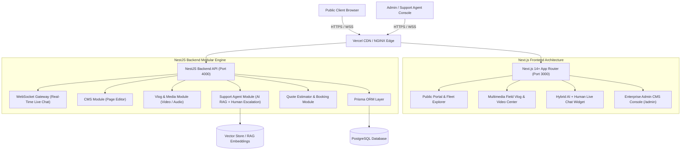
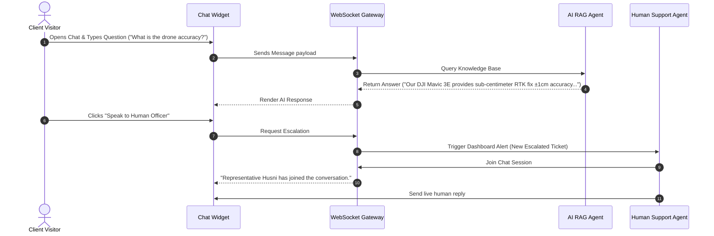

# ARCHITECTURE.md — Enterprise Next.js + NestJS Architecture Specification

This document details the system design, data flow, component hierarchy, backend modularity, and security architecture for the **Geospatial Works Enterprise Platform** including the **Admin Panel**, **Multimedia Vlog**, and **Hybrid AI + Human Support Agent Desk**.

---

## 1. System High-Level Topology



---

## 2. Updated Prisma Data Models

```prisma
datasource db {
  provider = "postgresql"
  url      = env("DATABASE_URL")
}

generator client {
  provider = "prisma-client-js"
}

enum Role {
  SUPER_ADMIN
  CONTENT_EDITOR
  SUPPORT_AGENT
  FIELD_SURVEYOR
}

model User {
  id        String   @id @default(uuid())
  email     String   @unique
  password  String
  name      String
  role      Role     @default(SUPPORT_AGENT)
  createdAt DateTime @default(now())
}

model VlogPost {
  id          String   @id @default(uuid())
  slug        String   @unique
  title       String
  summary     String
  content     String   // Rich Markdown / HTML
  videoUrl    String?  // HLS / MP4 aerial flight clip
  audioUrl    String?  // Audio podcast / field note
  thumbnail   String
  author      String
  category    String   // drone-survey, rtk-gnss, gis-mapping
  published   Boolean  @default(true)
  publishedAt DateTime @default(now())
}

model CmsSection {
  id          String   @id @default(uuid())
  sectionKey  String   @unique // hero, about, services, fleet, team
  title       String
  subtitle    String?
  contentJson Json     // Flexible CMS JSON configuration payload
  updatedAt   DateTime @updatedAt
}

model SupportTicket {
  id          String        @id @default(uuid())
  clientName  String
  clientEmail String?
  clientPhone String
  status      String        @default("BOT_ACTIVE") // BOT_ACTIVE, ESCALATED_HUMAN, RESOLVED
  assignedTo  String?       // Support Agent User ID
  messages    ChatMessage[]
  createdAt   DateTime      @default(now())
}

model ChatMessage {
  id        String        @id @default(uuid())
  ticketId  String
  sender    String        // CLIENT, AI_BOT, HUMAN_AGENT
  text      String
  createdAt DateTime      @default(now())
  ticket    SupportTicket @relation(fields: [ticketId], references: [id])
}
```

---

## 3. Hybrid AI + Human Support Agent Workflow


