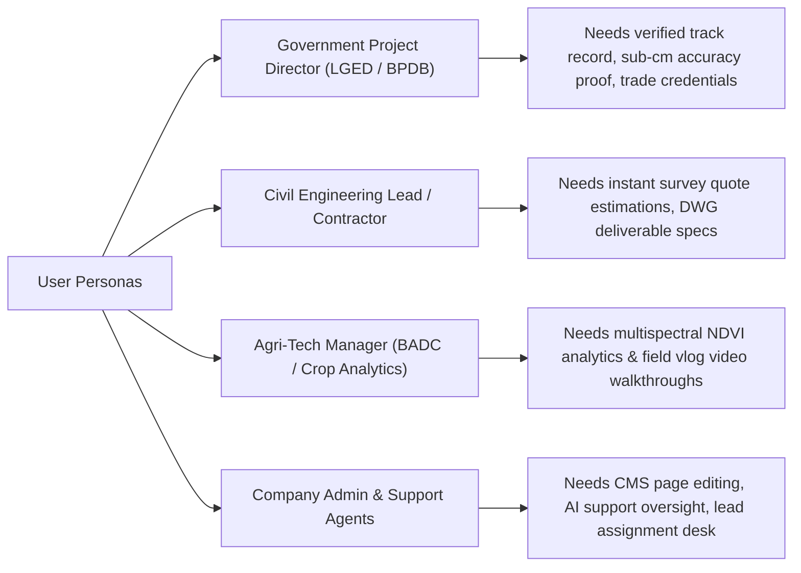

# PROJECT.md — Geospatial Works Enterprise Platform Specification

> **Company Legal Name:** Geospatial Works  
> **Tagline:** *Advanced Land Survey, Geospatial Solutions & Engineering Consultancy Firm*  
> **Core Slogan:** *"TO KEEP MOVING FORWARD."*  
> **Target Audience:** Government Ministries (LGED, BPDB, Ministry of Land), Infrastructure Developers, Agricultural Corporations, Urban Planners, Institutional Clients.

---

## 1. Executive Vision & Objectives

**Geospatial Works** is Bangladesh's premier geospatial engineering consultancy specializing in sub-centimeter land surveying, autonomous UAV drone photogrammetry, remote sensing, hydrographic bathymetric surveys, and civil engineering design.

The **Geospatial Works Enterprise Platform** is a full-stack web application featuring:
1. High-Tech Dark Mode Public Portal with real-time GNSS telemetry and instant survey cost calculator.
2. **Multimedia Field Vlog & Video Center** for aerial drone flight logs, audio field reports, and project showcases.
3. **Hybrid AI + Human Support Agent Desk** for 24/7 intelligent client consultations and live representative takeover.
4. **Full Admin Control Panel & Dynamic CMS** for editing landing page sections, managing lead bookings, publishing vlog content, and reviewing analytics.

---

## 2. Target User Personas

---

## 3. Comprehensive Feature Modules

### 3.1 Public Portal & Interactive HUD
* **Emerald Obsidian & Cyber Grid Aesthetic:** Glassmorphic cards, glowing radar sweep visualizers, and sub-centimeter accuracy badges.
* **Real-time GNSS Telemetry Simulator:** Live coordinates ticker updating at 2.5-second intervals with sub-centimeter RTK FIX accuracy indicators.
* **Interactive Fleet Explorer:** Categorized showcase for RTK GNSS receivers (CHCNAV i83), UAV Drones (DJI Mavic 3E/Multispectral, Matrice 4E), total stations, and GIS software suites.
* **Milestone Projects Filter:** Interactive filtering for major national projects across 64 districts.
* **Instant Survey Cost Estimator:** Calculates estimated BDT cost ranges based on survey type, acreage/extent, and deliverables.

### 3.2 Multimedia Field Vlog & Media Hub (`/vlog`)
* **Video & Aerial Flight Clips:** Native HLS / MP4 video player integration for drone flight passes, 3D point cloud scans, and site surveys.
* **Audio Podcast & Field Notes:** Embedded audio player for field surveyor voice notes, site inspection logs, and technical interviews.
* **Rich Article Publishing:** Technical blogs on drone photogrammetry, RTK GNSS calibration, and GIS cartography.

### 3.3 Hybrid AI + Human Support Desk
* **AI Support Agent (RAG-Powered):** 24/7 automated chatbot answering client queries regarding survey pricing, drone capabilities, accuracy metrics, and booking procedures using RAG knowledge bases.
* **Human Live Chat Takeover:** Seamless escalation to human support representatives with real-time WebSocket chat, client contact collection, and ticket history.

### 3.4 Full Enterprise Admin Panel (`/admin`)
* **Dynamic Landing Page CMS:** Live visual editor for changing headlines, hero banners, core services, hardware inventory, and team profiles.
* **Lead & Inspection Management Desk:** Real-time dashboard for reviewing quote requests, assigning field surveyors, and updating project statuses.
* **Media Library Manager:** Upload, tag, and organize drone videos, audio flight logs, and CAD DWG assets.
* **Analytics & Conversion Metrics:** Track pageviews, quote calculator usages, lead conversion rates, and chatbot interaction logs.
* **Role-Based Access Control (RBAC):** Super Admin, Content Editor, Support Agent, and Field Surveyor roles.
