# Presentation Extraction: 20261030 Company Profile.pptx

Source: `/home/alvee/Desktop/afgan jalebi/20261030 Company Profile.pptx`

Total Slides: 45

---

## Slide 1

GEOSPATIAL WORKS

Corporate Brochure

CONCULTANCY

IT

SURVEY

1st CLASS CONTRACTOR AND SUPPLIER

…….Where Engineering Meets Precision

### Images in Slide 1:

---

## Slide 2

GEOSPATIAL WORKS

ABOUT US

Geospatial Works is an engineering, geospatial, and precision surveying consultancy delivering integrated technical solutions for infrastructure development, spatial planning, and sustainable resource management. Combining engineering expertise with advanced geospatial technologies, modern surveying instruments, and digital design capabilities, we support projects from field data acquisition and spatial analysis to engineering design and 3D visualization. Our multidisciplinary approach emphasizes technical precision, innovative solutions, efficient workflows, and timely delivery- helping clients make informed decisions and achieve reliable project outcomes.

01

### Images in Slide 2:

---

## Slide 3

GEOSPATIAL WORKS

OUR VISION

OUR MISSION

To be marked as global excellency in engineering and geospatial consultancy services, recognized for technical brilliance, innovative solutions, and sustainable infrastructure development.

Helping our clients make informed decisions and achieve sustainable project outcomes by providing sustainable engineering solutions, precise, efficient, and research oriented geospatial, and surveying results through technical expertise, advanced technology, and a commitment to quality and timely data delivery.

02

### Images in Slide 3:

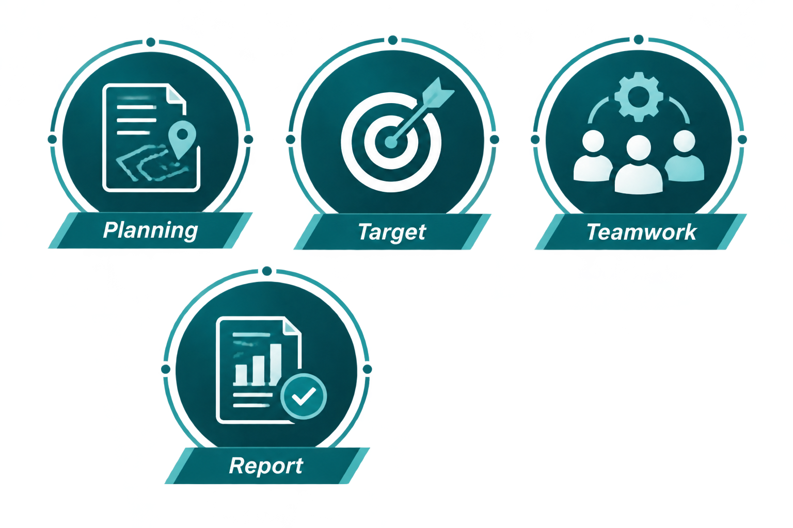

---

## Slide 4

GEOSPATIAL WORKS

OUR CORE VALUES

03

### Images in Slide 4:

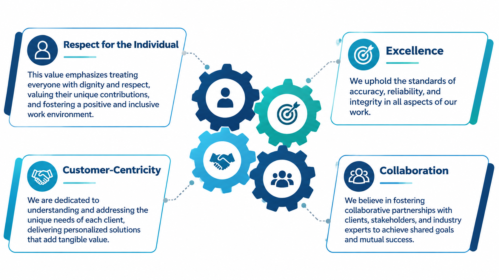

---

## Slide 5

GEOSPATIAL WORKS

04

WHY CHOOSE US

### Images in Slide 5:

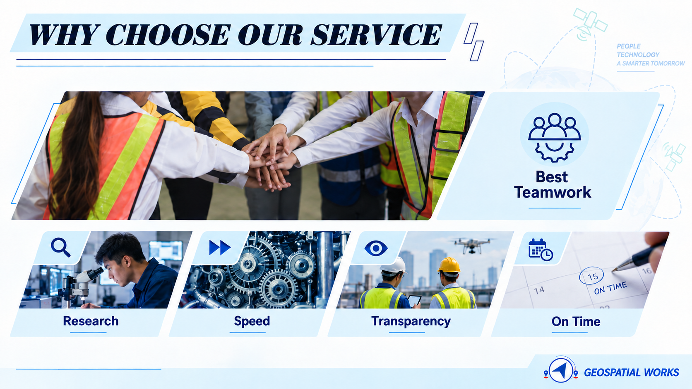

---

## Slide 6

05

GEOSPATIAL WORKS

Topographic, land, UAV, hydrographic, construction, and engineering surveys.

Architectural, civil, structural, environmental, and electromechanical design, drawings, and supervision.

Geospatial planning, GIS management, spatial analysis, and customized solutions.

Satellite imagery analysis, land cover mapping, change detection, and environmental monitoring.

Precision mapping, spatial analysis, data management, and GIS application development.

Development project feasibility, cost estimation, and BOQ, MOQ, and BOM preparation.

SERVICES WE PROVIDE

### Images in Slide 6:

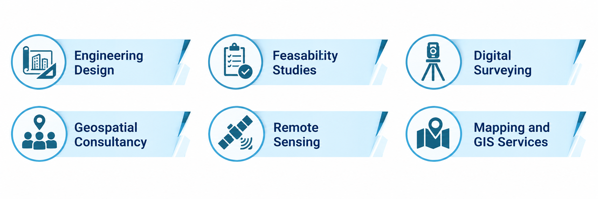

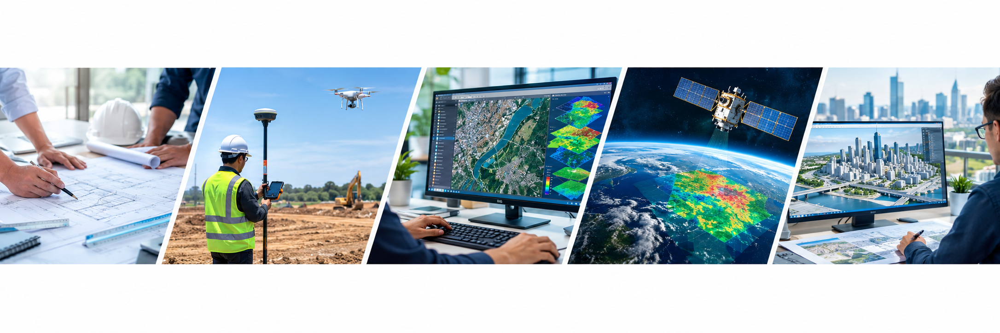

---

## Slide 7

Monitoring

Infrastructure Mapping

Geospatial Services

Design

GIS and Mapping

SERVICES WE PROVIDE

GEOSPATIAL WORKS

Road and highway route alignment, corridor and interchange design

Scheme plan, concept plan and subdivision design drawings

Access roads, haul roads, intersections and over/under passes

As-built drawings, profiles and sections

Data conversion, digitization, transformation and vectorization

Road and utility mapping

Asset inventory and mapping

Infrastructure condition documentation

Road alignment and corridor mapping

Drainage and utility network mapping

Bridge and structure documentation

Satellite mapping, high resolution

Ground based topographic mapping

Utility & service mapping

Land use and resource mapping

High-precision mapping

Data conversion and management

Thematic mapping and spatial analysis

Different GIS-based Application Development

High resolution satellite and UAV imagery

Surveying for remote sensing

Feature & attribute data collection for asset management

Ground control point surveys for satellite imagery & aerial photography

Pre- and post marking for photogrammetry o

Geographic Information services

Image processing & rectification

Construction progress monitoring

Land-use and land-cover change detection

Deformation and elevation monitoring

Earthwork and stockpile volume monitoring

Infrastructure condition monitoring

Environmental and site monitoring

Multi-temporal satellite image analysis

Periodic drone-based site inspection

Survey accuracy verification

Data validation and quality control

Standards and specification compliance

Coordinate and elevation checks

Ground control point verification

Positional accuracy assessment

Field data and deliverable review

Final map and report quality checks

14

Quality Assurance

### Images in Slide 7:

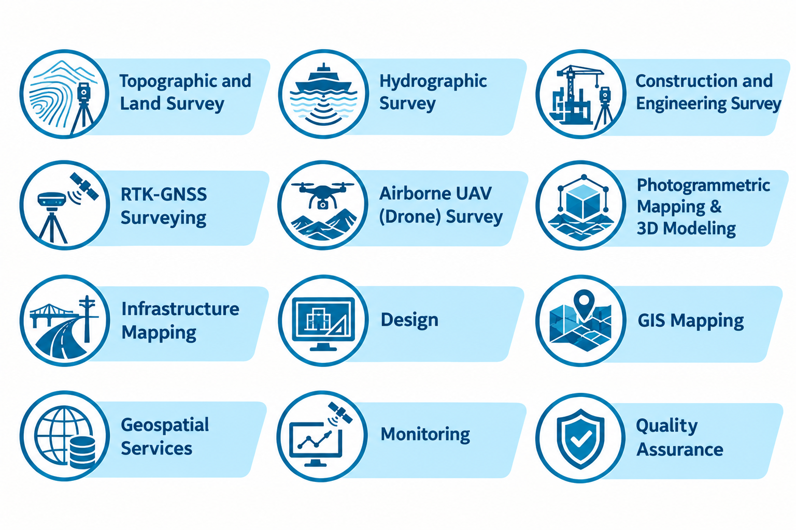

---

## Slide 8

Airborne UAV (Drone) Survey

Site survey and investigations

Cadastral and boundary surveys, land parcel demarcation

GNSS reference networks

Digital surface, elevation & terrain modelling (DSM/DEM/DTM) with full contour

Topographic mapping

GeoTIFF and GIS-ready output formats

Feature extraction

Topographic and Land Survey

Hydrographic

Survey

Engineering and Construction Survey

RTK GNSS Survey

Photogrammetric Mapping and 3D Modeling

Civil engineering surveys

Control network design and establishment

Precise levelling & alignment

Setting out of structures, embedded elements & machinery

Building and site

Dimensional surveys

Building Information Modeling (BIM)

GEOSPATIAL WORKS

Hydrographic & bathymetric surveys

River, lake & seabed mapping

Current velocity surveys

water-level measurements

riverbed profiling, and bathymetric mapping

Centimetre-level horizontal and vertical accuracy

Ground control point establishment

engineering-grade site surveys and boundary delineation

Real-time coordinate measurement

Aerial image acquisition

Drone-based land mapping

Orthomosaic and elevation model generation

Vegetation analysis product

< 3 cm GSD/ Px resolution

Large-area and inaccessible site surveys

Construction site aerial inspection

Orthomosaics and mesh models compatible with Agisoft Metashape, DJI Terra, and AutoCAD.

High-density UAV point cloud acquisition

3D surface reconstruction

Point cloud generation

Digital surface model (DSM) development

Contour map generation

Building and terrain visualization

13

SERVICES WE PROVIDE

### Images in Slide 8:

---

## Slide 9

GEOSPATIAL WORKS

FEASIBILITY, DESIGN &

ENGINEERING SECTION

Geospatial Works provides comprehensive feasibility studies, engineering design, and technical drawing services in accordance with national and international standards. Geospatial Works a capable partner for complex, high-specification  civil, structural, architectural drawings and engineering solutions to support informed decision-making and effective project planning. Our team evaluates technical and financial requirements, identifies potential challenges, estimates project costs, and delivers practical, sustainable engineering solutions from concept to completion.

Design & Drawing

Engineering

Feasibility

06

### Images in Slide 9:

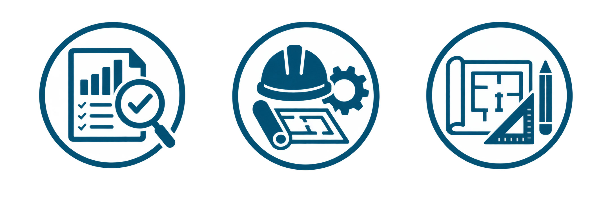

---

## Slide 10

FEASIBILITY, DESIGN &

ENGINEERING SECTION

07

GEOSPATIAL WORKS

Preparation of detailed Bills of Quantities through measurement of work items from engineering drawings and specifications, including applicable unit rates and estimated costs for project implementation.

Preparation of Bills of Quantities (BOQ)

Preparation of Bills of Materials (BOM)

Identification and quantification of required construction materials based on project drawings and specifications to support material planning, procurement, and resource management.

Preparation of Material Quantity and Cost (MQO)

Calculation of material quantities and associated costs based on engineering drawings and design specifications to develop structured material quantity schedules for project budgeting and implementation.

Feasibility Studies

Feasibility assessment of site conditions, technical requirements, project constraints, and development opportunities to evaluate project viability and support informed planning and decision-making.

Feasibility Studies

Technical advisory services on survey equipment, specifications, field procedures, and data collection methodologies to ensure accurate, reliable, and efficient surveying operations..

Project Cost Estimation and Budgeting

Project cost analysis and budget preparation through assessment of work quantities, materials, labor, equipment, and operational expenses to support effective financial planning.

### Images in Slide 10:

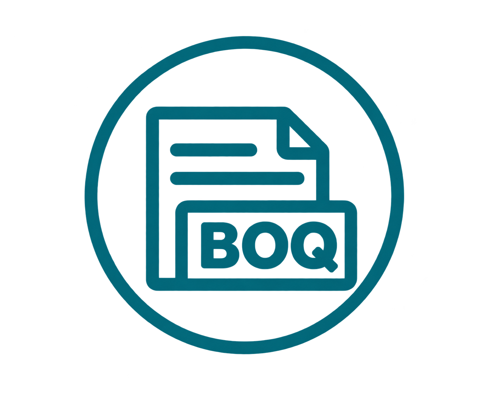

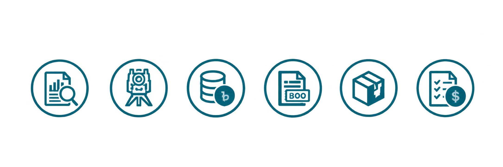

---

## Slide 11

08

GEOSPATIAL WORKS

Architectural Design

Architectural planning, building design, space optimization, and functional layouts tailored to project requirements, aesthetics, and usability.

Civil & Structural Engineering

Structural analysis, design, and assessment for buildings, bridges, and critical infrastructure, Site development, earthworks, drainage design, road construction, foundations, and civil infrastructure for all project scales and terrain types focusing on safety, longevity, and code compliance

Environmental

Engineering

Environmental assessment, pollution control, waste management, and sustainable engineering solutions to support environmental protection and regulatory compliance.

Landscape

Design

Landscape planning, outdoor space design, green infrastructure, and site beautification to create functional, sustainable, and visually appealing environments.

Electromechanical

Systems Design

Integrated mechanical, electrical design for commercial, industrial, and high-specification facilities.

Design Documentation

Comprehensive structural surveys, site evaluations, building inspections, and detailed technical documentation for due diligence and project planning

FEASIBILITY, DESIGN &

ENGINEERING SECTION

### Images in Slide 11:

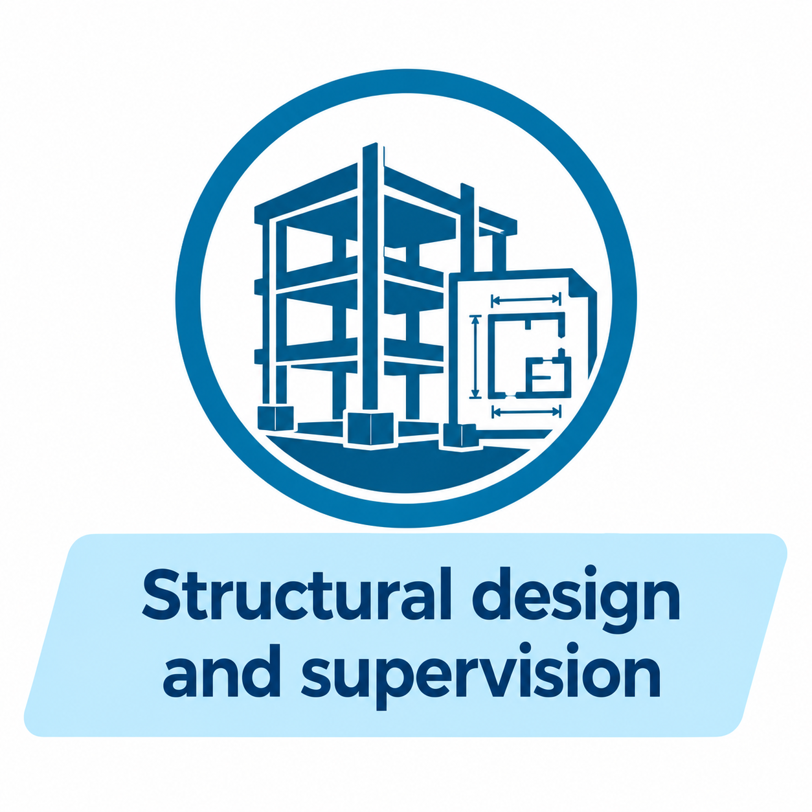

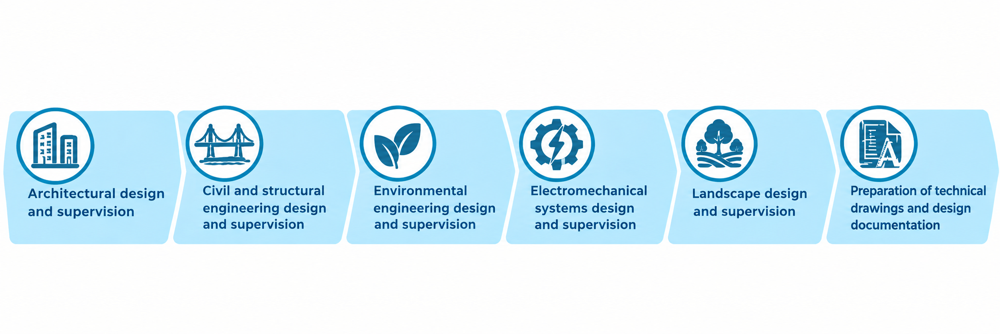

---

## Slide 12

09

GEOSPATIAL WORKS

GEOSPATIAL SERVICES & CONSULTANCY SECTION

Geospatial Works provides integrated geospatial services, solutions and consultancy services to support effective planning, informed decision-making, and efficient spatial data management. By combining advanced surveying technologies, GIS, remote sensing, spatial analysis, and technical expertise, we transform accurate field data into actionable insights, high-quality maps, and digital models. Our solutions support infrastructure development, environmental management, urban planning, resource management, and diverse development initiatives, tailored to meet specific project requirements.

Geospatial

Consultancy

Geospatial

Solution

Geospatial Services

### Images in Slide 12:

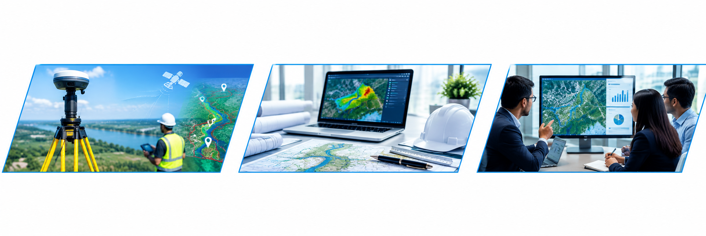

---

## Slide 13

Photogrammetry and 3D Mapping

Geospatial Database and Digital Mapping

Remote Sensing and Image Analysis

Terrain and Elevation Analysis

Geographic Information Systems (GIS)

10

GEOSPATIAL WORKS

Spatial data collection, mapping, analysis, and visualization to support informed planning and location-based decision-making.

Accurate 2D maps, orthomosaics, 3D models, and terrain surfaces generated from drone and aerial imagery.

Satellite and aerial imagery processing, image classification, feature extraction, and change detection for reliable spatial insights.

Digital elevation models, contour mapping, slope analysis, and terrain assessment for engineering and land development.

Geospatial data management, database design, digital map production, and spatial integration for efficient project workflows.

GEOSPATIAL SERVICES & CONSULTANCY SECTION

### Images in Slide 13:

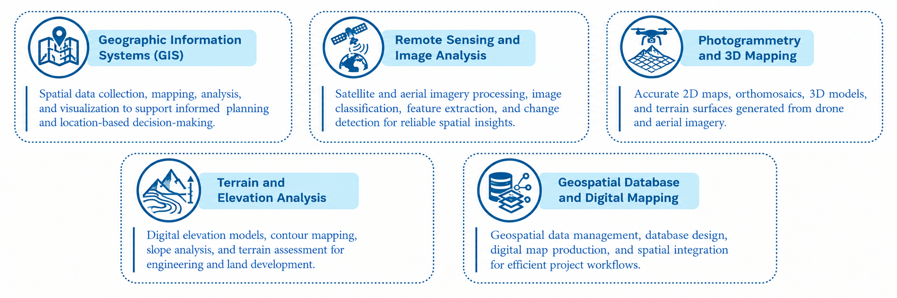

---

## Slide 14

Spatial Data Analysis and Interpretation

GIS Implementation and Management

Customized Geospatial Solutions

Strategic Geospatial Planning

11

GEOSPATIAL WORKS

Geospatial planning and site assessment to support informed development and sustainable land-use decisions.

Spatial analysis and data interpretation to identify patterns, trends, and meaningful insights.

GIS database development, mapping, and system management for efficient spatial data handling.

Tailored GIS applications, mapping tools, and spatial solutions to meet specific project requirements.

GEOSPATIAL SERVICES & CONSULTANCY SECTION

Technical Advisory Services

Technical guidance on surveying, GIS methodologies, geospatial technologies, and project implementation.

Spatial Decision Support

Geospatial analysis and mapping to support evidence-based planning and effective decision-making.

### Images in Slide 14:

---

## Slide 15

12

GEOSPATIAL WORKS

DIGITAL SURVEYING

Geospatial Works operates a full-capability digital surveying and geospatial intelligence division, delivering engineering-grade aerial data for construction, infrastructure, urban area, environmental monitoring, agricultural assessment, natural resource management and government, non-government projects. Our RTK/GNSS-enabled platforms achieve centimetre-level accuracy, reducing survey costs against traditional methods and delivering outputs within efficient timebound.

mm Level

Horizontal-Vertical positional accuracy

Hybrid Survey

Uses of Traditional and Modern

survey equipment

RAPID

Delivery within few business timeline

DIVERSE

Output formats supported

INTEGRATED

Surveying, GIS, UAV, and remote sensing capabilities

### Images in Slide 15:

---

## Slide 16

GEOSPATIAL WORKS

OUR ENGINEERING PROJECTS

21

Project Name : Construction of Necessary Number of Ticket Counters, Modernization of Passenger Waiting Rooms, Provision of Standard Toilet Facilities, Improvement of Drainage System, and Development of Passageways at Gabtoli Inter-District Bus Terminal under Dhaka North City Corporation.

Duration: June 2026 – September 2026

Project Description : The project involved digital surveying and comprehensive improvement planning of Gabtoli Bus Terminal, Dhaka. The drone survey was incorporated covering 58.527 acres and 0.236 sq km. The scope of work included the design of two terminal buildings, expansion and reorganization of bus counters, development of an efficient bus circulation plan, improvement of the existing drainage system, and provision of new storm-water drainage lines. The project also included drainage system design, preparation of detailed design drawings, and Bill of Quantities (BOQ) to support cost estimation and future implementation. The overall objective was to improve terminal functionality, passenger facilities, bus movement efficiency, and storm-water management.

### Images in Slide 16:

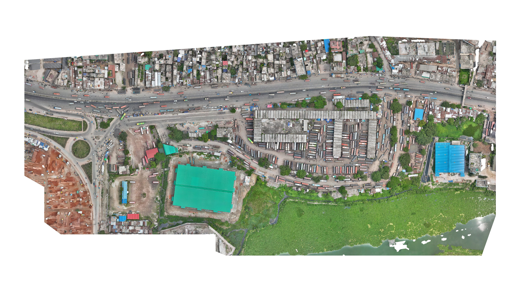

---

## Slide 17

GEOSPATIAL WORKS

OUR ENGINEERING PROJECTS

22

Relevant Outputs

3D Model Output

Digital survey

Ground Floor Plan

1st Floor Plan

Etabs 3D Model View

### Images in Slide 17:

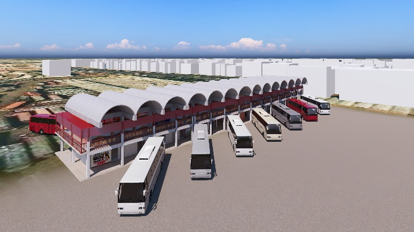

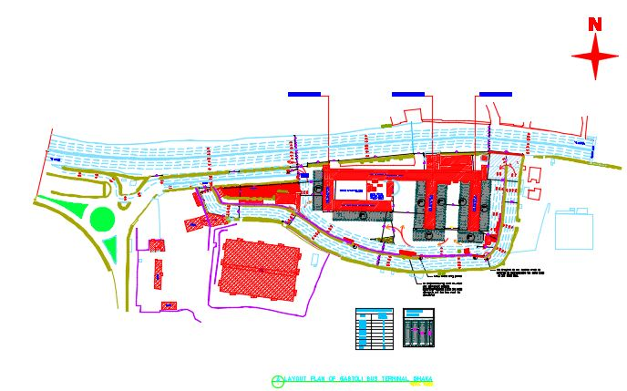

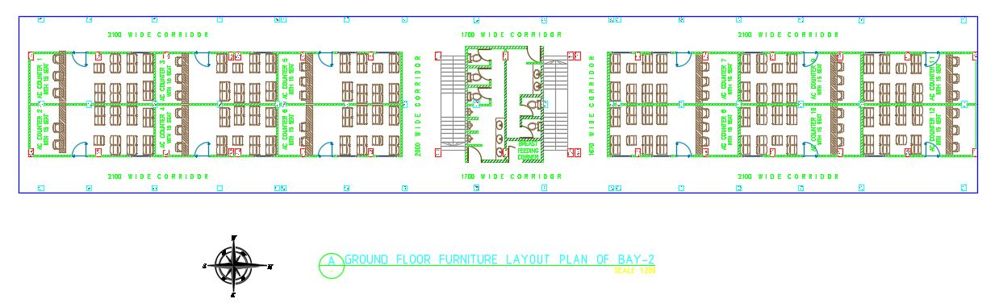

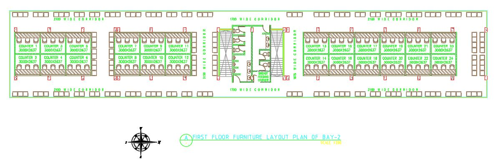

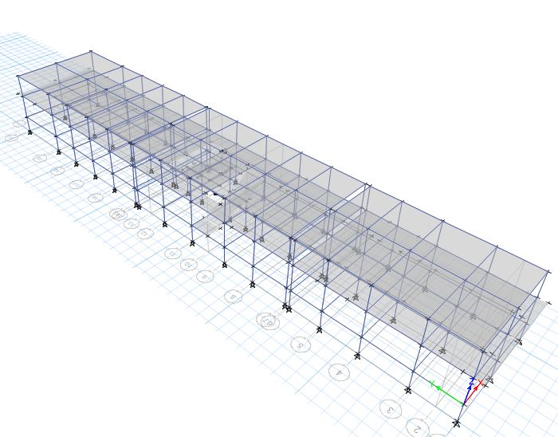

---

## Slide 18

GEOSPATIAL WORKS

OUR ENGINEERING PROJECTS

23

Project Name : Road Improvement Works including Construction of RCC Median, Drain, Footpath, Passenger Shed, Grill Fencing and Installation of Traffic Signs from Gulshan-1 Intersection to Progati Sarani (Gulshan-Badda Link Road), and Road & Footpath Improvement of Road No. 130 (Part) and Road No. 134 under Dhaka North City Corporation.

Duration: August 2026 – October 2026

Project Description : The project involved road infrastructure improvement works under Dhaka North City Corporation (DNCC), including the construction of RCC medians, drainage systems, footpaths, passenger sheds, grill fencing, and installation of traffic signs along the Gulshan-1 Intersection to Progati Sarani (Gulshan-Badda Link Road) corridor. The scope also included road and footpath improvement works on Road No. 130 (Part) and Road No. 134, as well as the design of a lake-side palisading system for bank protection and soil erosion control. The drone survey was incorporated covering 71.64 acres and 0.28 sq km and 1.019 km by legnth. Additionally, the project involved the preparation of the Bill of Quantities (BOQ) to support cost estimation and implementation planning. These interventions aimed to improve road infrastructure, pedestrian accessibility, traffic safety, drainage facilities, and lake bank stability.

### Images in Slide 18:

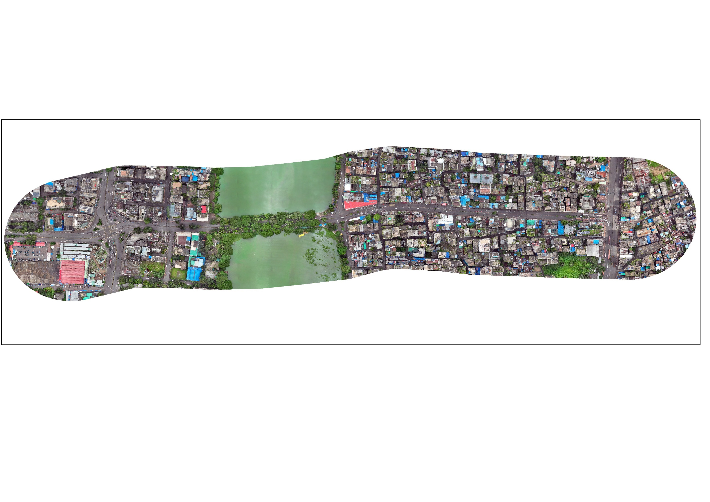

---

## Slide 19

GEOSPATIAL WORKS

OUR ENGINEERING PROJECTS

24

Relevant Outputs

3D Model Output of Waiting  Shelter

Drain Layout Plan

Waiting  Shelter Plan

Section for Road

### Images in Slide 19:

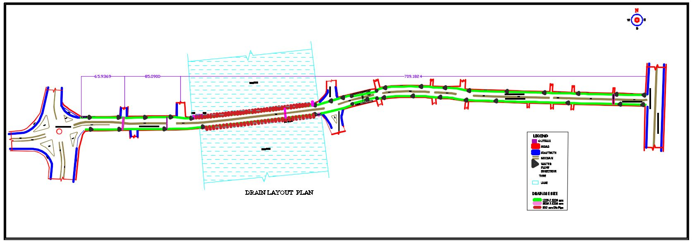

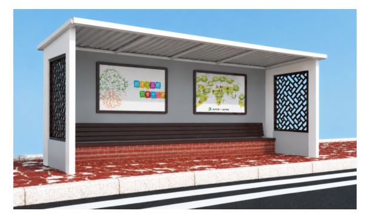

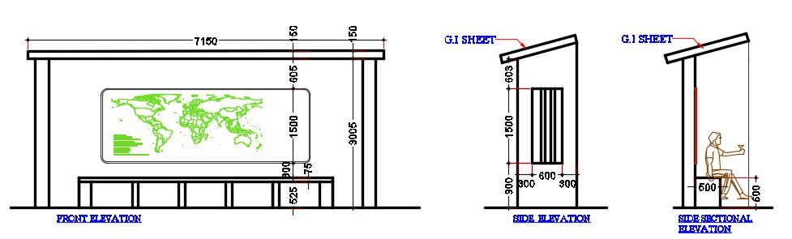

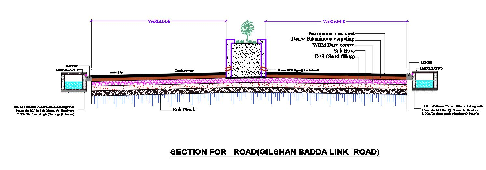

---

## Slide 20

GEOSPATIAL WORKS

OUR ENGINEERING PROJECTS

25

Project Name : Construction of Necessary Number of Ticket Counters, Modernization of Passenger Waiting Rooms, Provision of Standard Toilet Facilities, Improvement of Drainage System, and Development of Passageways at Mohakhali Inter-District Bus Terminal under Dhaka North City Corporation.

Duration: September 2026 - Continue

Project Description : The project involved digital surveying and comprehensive improvement planning of Mohakhali Bus Terminal, Dhaka. The drone survey was incorporated covering 37.152 acres and 0. 15 sq km. The scope of work included the expansion and reorganization of bus counters, development of an efficient bus circulation plan, improvement of the existing drainage system, and provision of new storm-water drainage lines. The project also included drainage system design, preparation of detailed design drawings, and Bill of Quantities (BOQ) to support cost estimation and future implementation. The overall objective was to improve terminal functionality, passenger facilities, bus movement efficiency, and storm-water management.

### Images in Slide 20:

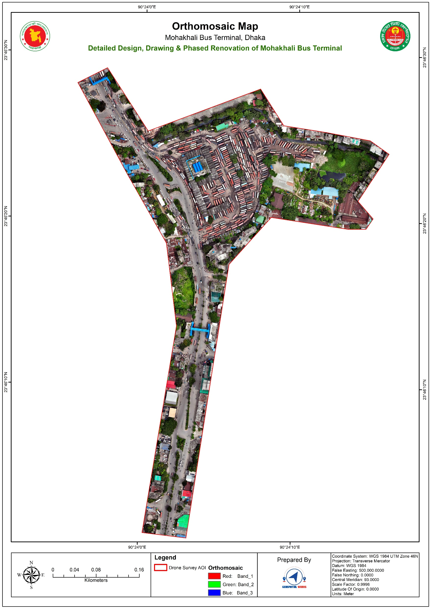

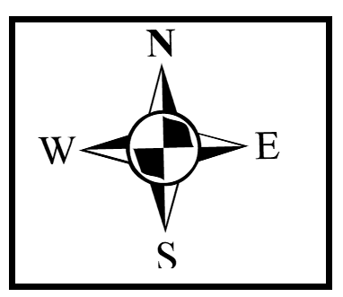

---

## Slide 21

GEOSPATIAL WORKS

OUR ENGINEERING PROJECTS

26

Relevant Outputs

Digital survey

Bus Counter Floor Plan

3D Model Output

AC Bus Counter Floor Plan

Non-AC Bus Counter Floor Plan

### Images in Slide 21:

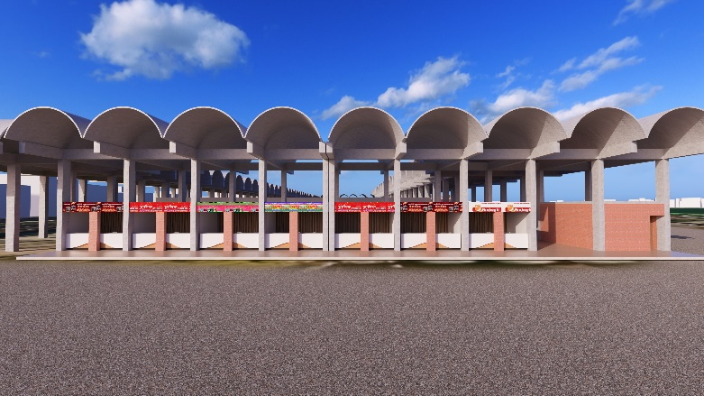

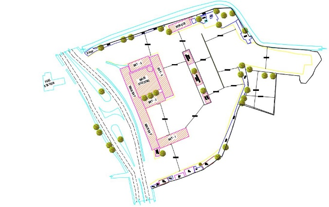

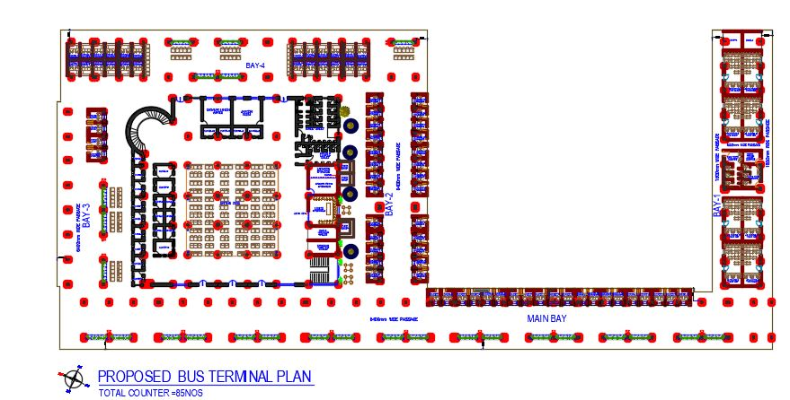

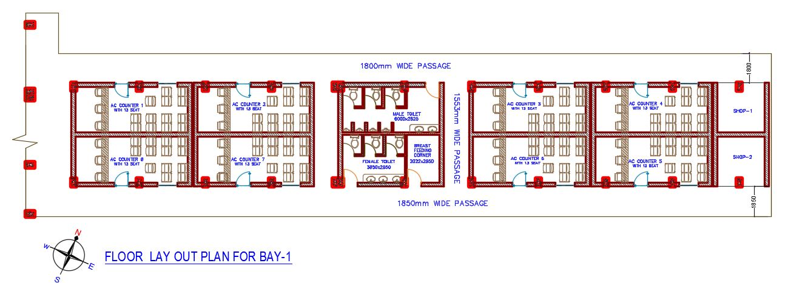

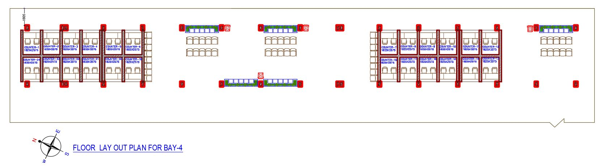

---

## Slide 22

GEOSPATIAL WORKS

OUR ENGINEERING PROJECTS

27

Relevant Outputs

Section for Drain

Section for Palisading

### Images in Slide 22:

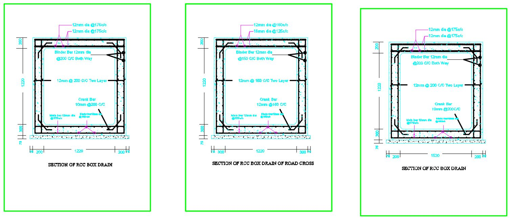

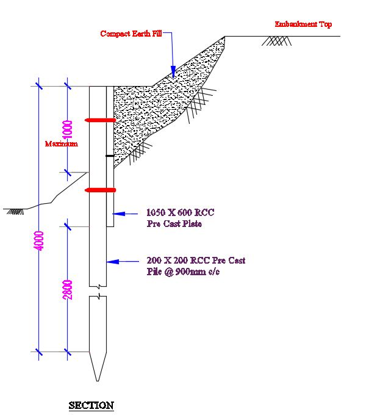

---

## Slide 23

GEOSPATIAL WORKS

30

Project Name: LTP of Sanitary Landfill at Moheshkhali SWM.

Mode of Work: Structural Design and Drawing.

Project Duration: April 2025- May 2025

Project Description: The project involved the structural design and preparation of drawings for the LTP (Landfill Treatment Plant) of the sanitary landfill under the Moheshkhali Solid Waste Management (SWM) project. The project was funded by the Japan International Cooperation Agency (JICA), implemented under the Local Government Engineering Department (LGED), and monitored by Nippon Koei Bangladesh Ltd. The project was undertaken to support waste management facilities serving the Rohingya community. The scope of work included structural design and drawing preparation, manual structural calculations, and the assessment of maximum bending moment, maximum shear force, and reinforcement requirements to support the design process. The work also involved technical discussions with Japanese engineers from Nippon Koei Bangladesh Ltd. regarding the structural design.

| Name of Client | Project Authority | Executive Authority | Project Location |
| --- | --- | --- | --- |
| OSMO CORPORATION | Nippon Koei Bangladesh Ltd. | Local Government Engineering Department (LGED) | Moheshkhali, Cox's Bazar, Bangladesh. |

OUR ENGINEERING PROJECTS

### Images in Slide 23:

---

## Slide 24

GEOSPATIAL WORKS

31

Relevant Outputs

OUR ENGINEERING PROJECTS

### Images in Slide 24:

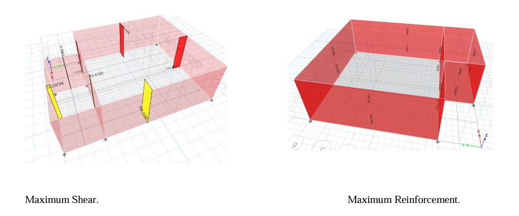

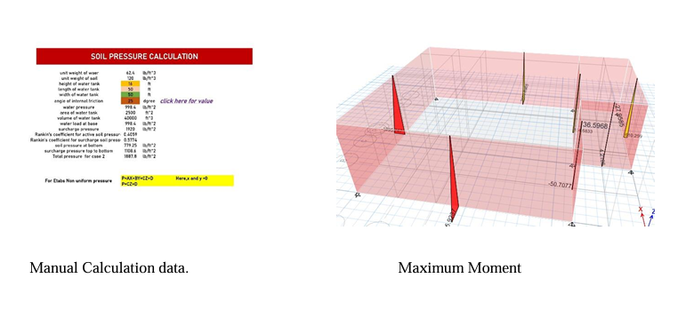

---

## Slide 25

GEOSPATIAL WORKS

OUR GEOSPATIAL PROJECTS

32

Project Name: Pilot Research Project on Irrigation Management and Web-based Agricultural Information System for Bangladesh (WEB-AIS) under Bangladesh Agricultural Development Corporation (BADC).

Project Description: The WEB-AIS pilot projectaims to improve irrigation management and agricultural planning through an integrated geospatial information system. Covering approximately 208.37 km² across 23 unions and 260 mouzas in the Manikganj region, the project involved GNSS/RTK surveying, UAV-based mapping, photogrammetric processing, and cadastral map digitization. Key outputs include high-resolution orthomosaics, elevation models, land-cover maps, irrigation networks, and groundwater pump inventories. The database documents 142.02 km² of agricultural land, 536.12 km of irrigation canals, and 9,834 irrigation pumps, providing essential spatial information for efficient water-resource management, evidence-based irrigation planning, and sustainable agricultural development..

Duration: September 2025 - Continue

### Images in Slide 25:

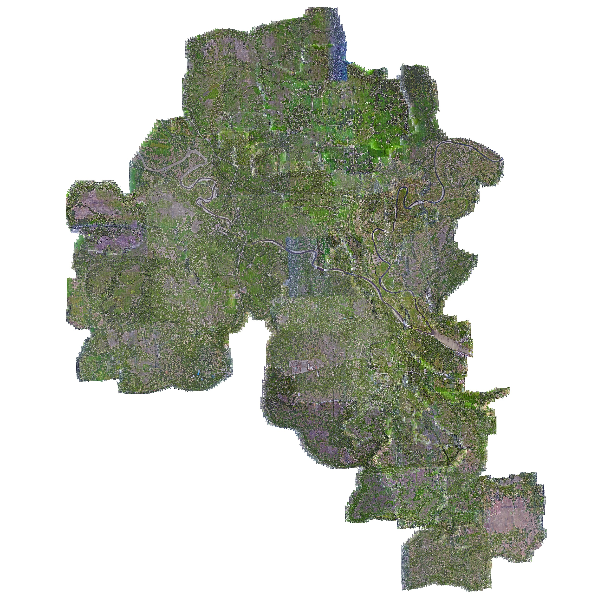

---

## Slide 26

GEOSPATIAL WORKS

OUR GEOSPATIAL PROJECTS

33

Relevant Outputs

Distribution of TBM and GCP Grid

Distribution of  Primary Control

Distribution of  Secondary Control

Distribution of Land Cover

Distribution of Hydrological Network

Distribution of Irrigation Canal

Distribution of Number of Pumps

### Images in Slide 26:

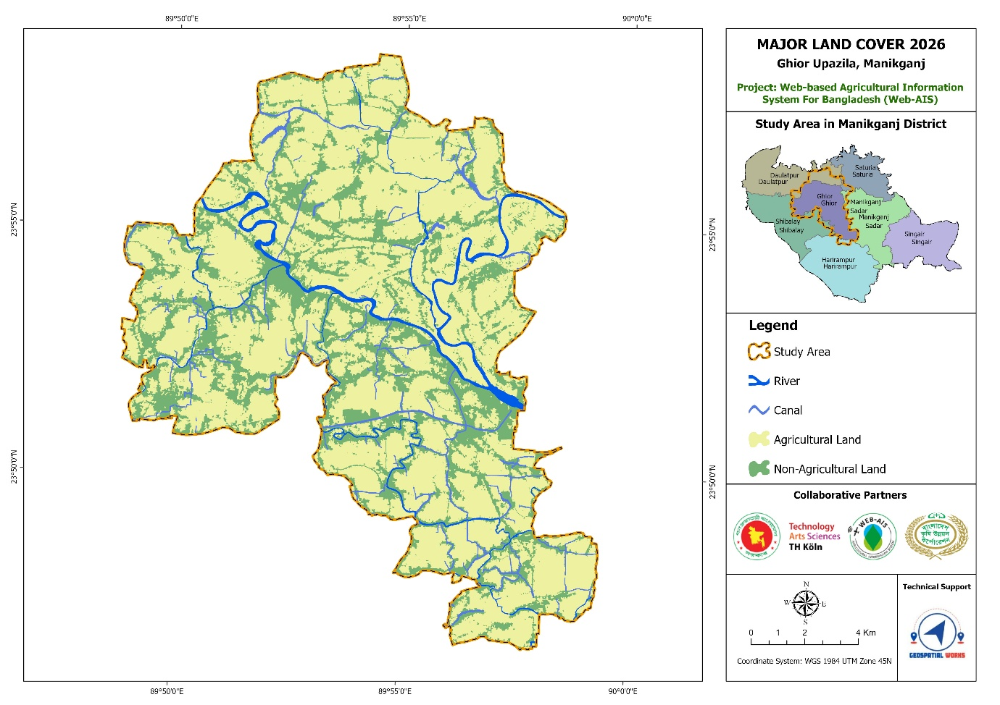

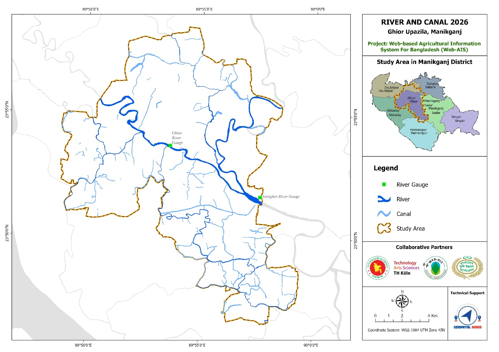

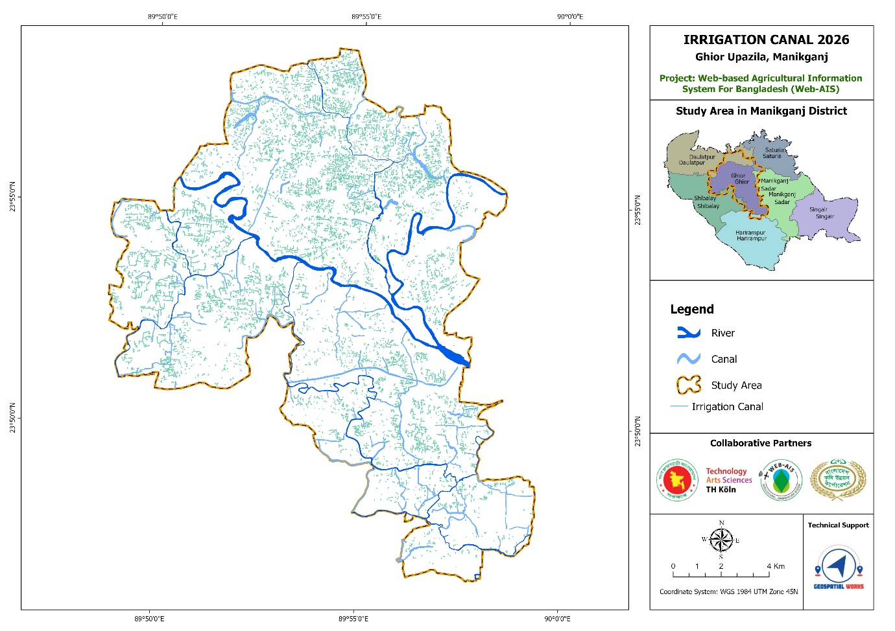

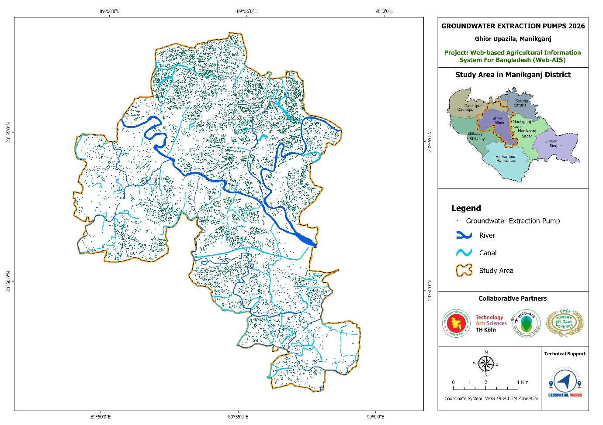

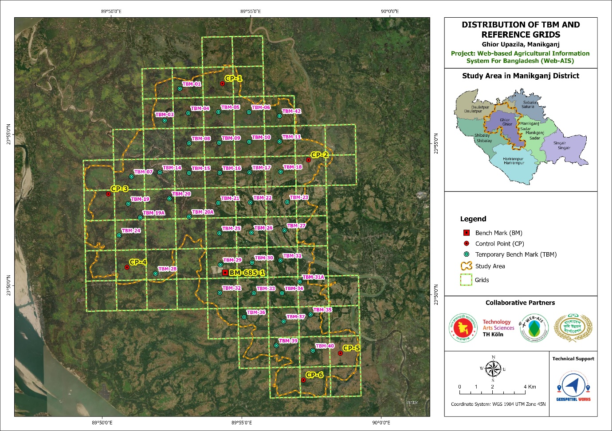

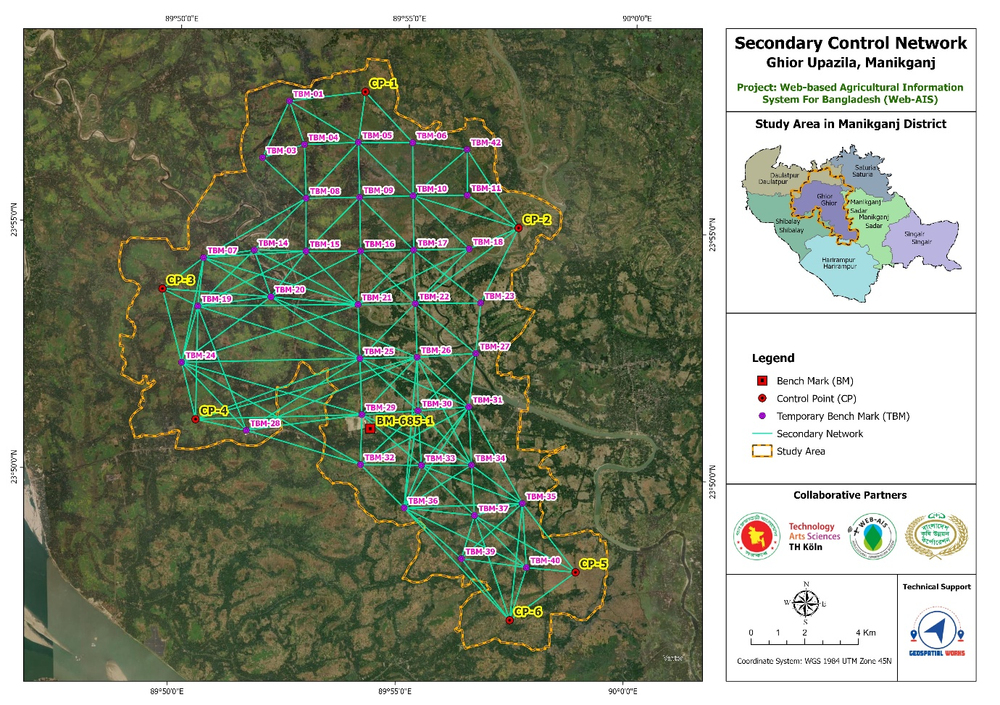

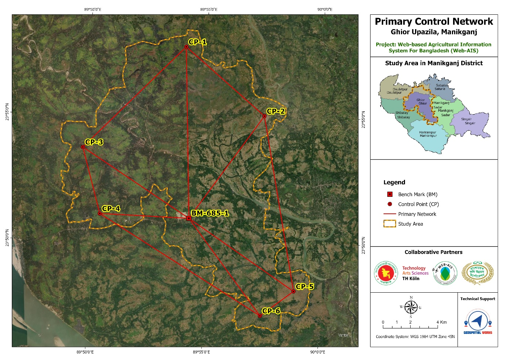

---

## Slide 27

GEOSPATIAL WORKS

28

Project Name: Installation of Water-Level Gauge Readers and Topographic Surveying at Three Locations in Gangarampur under the WEB-AIS Project of Bangladesh Agricultural Development Corporation (BADC).

Project Description: The project involved the installation and adjustment of river water level gauge readers at three monitoring locations in Gangarampur Union, Batiaghata Upazila, Khulna District, Bangladesh, under the Bangladesh Agricultural Development Corporation (BADC). The scope of work included conducting levelling surveys to establish accurate Reduced Levels (RLs), performing Real-Time Kinematic (RTK) GNSS observations to determine precise geographic coordinates and elevations, and establishing temporary benchmarks to ensure reliable geodetic control. The project also involved measuring existing water depths, constructing bamboo support platforms, and installing gauge readers at the Jhopjhopia River, Guiyer Canal Opening near Amtola Canal, and the Y-section point of Guiyer Canal.

Duration: September 2025 - Continue

OUR GEOSPATIAL PROJECTS

### Images in Slide 27:

---

## Slide 28

GEOSPATIAL WORKS

29

Final Water Level: 1.83 m

Jhopjhopia River Site

Final Water Level: 0.229 m

Guiyer Canal Opening near Amtoala Canal

Y-Section Point of Guiyer Canal

Final Water Level: 1.273 m

Relevant Outputs

OUR GEOSPATIAL PROJECTS

### Images in Slide 28:

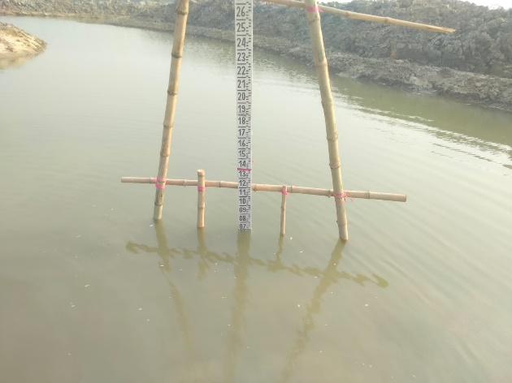

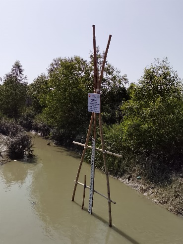

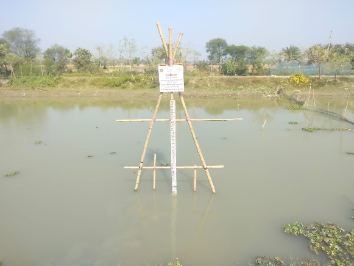

---

## Slide 29

GEOSPATIAL WORKS

OUR QUICK DELIVERY PROJECTS

34

Project Name: The Abdulpur Railway Bypass under subproject 2 Railway Connectivity Improvement Preparatory Facility (RCIPF) Project (ADB Loan No: 6030 BAN)

Project Description: The Abdulpur Railway Bypass Project involved a comprehensive topographic and physical feature survey across approximately 40 acres in Lalpur Upazila, Natore District, to support feasibility assessment, railway alignment planning, and detailed engineering design. The methodology integrated UAV photogrammetry, RTK GNSS, and Electronic Total Station (ETS) surveys, using 17 Ground Control Points (GCPs) and high-resolution imagery acquired by a DJI Matrice 4E UAV. Photogrammetric processing and GIS/CAD analysis generated georeferenced orthomosaics, DSM, DTM, 20 cm interval contour maps, cross-sections, LULC maps, utility maps, and railway infrastructure maps. Field observations documented existing terrain, railway infrastructure, roads, buildings, drainage networks, utilities, and property boundaries. The resulting geospatial database provide reliable spatial information with consistent centimetre-level vertical accuracy.

Duration: August 2026 (Within 14 Days)

### Images in Slide 29:

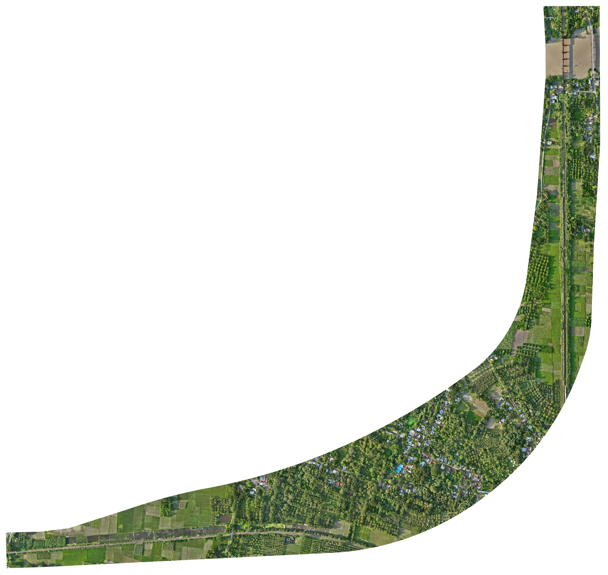

---

## Slide 30

GEOSPATIAL WORKS

OUR QUICK DELIVERY  PROJECTS

37

Relevant Outputs

Digital Surface Model

Digital Terrain Model

High Resolution Orthomosaic

0.20 cm Contour

Land Use Land Cover (LULC)

Utility with Existing Features

Railway Infrastructure

### Images in Slide 30:

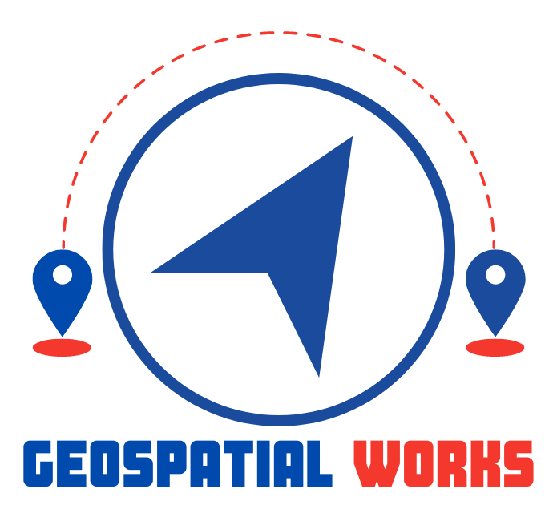

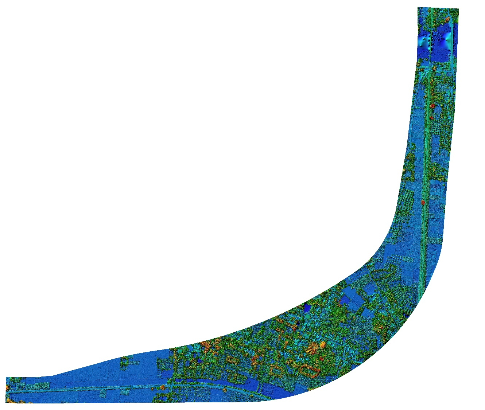

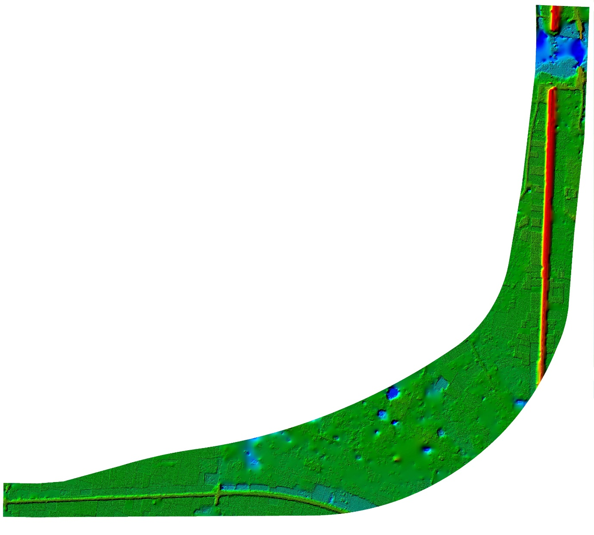

---

## Slide 31

GEOSPATIAL WORKS

OUR QUICK DELIVERY PROJECTS

36

Project Name: Preparation of Concept Design & Implementation Plan for Bus Route Rationalization and Company-Based Operation of Bus Service in Dhaka, by Dhaka Transport Coordination Authority (DTCA)

Project Description: The survey activities included Traffic Count Survey, UAV-based Drone Survey, and Origin–Destination (OD) Survey at important roads and intersections across Dhaka city. The The drone survey was incorporated covering 8686.886 acres and 35.15 sq km and 150.265 by legnth. The methodology integrated UAV photogrammetry, RTK GNSS, using Ground Control Points (GCPs) and high-resolution imagery acquired by a DJI Matrice 4E UAV. Photogrammetric processing and GIS/CAD analysis generated georeferenced orthomosaics, DSM. These surveys provided essential traffic and spatial data to support passenger transport planning, bus route rationalization, and the preparation of the project’s concept design and implementation plan.

Duration: September 2026 (within 30 Days)

### Images in Slide 31:

---

## Slide 32

GEOSPATIAL WORKS

OUR QUICK DELIVERY  PROJECTS

37

Relevant Outputs

Digital Surface Model (Small Section)

High Resolution Orthomosaic (Small Section)

### Images in Slide 32:

---

## Slide 33

18

OUR MILSTONE PROJECTS

GEOSPATIAL WORKS

In 2026

In 2026

In 2026

208.37 km² data collection across 23 unions and 260 mouzas

Data collection across 71.64 acres (0.28  km² )

Construction  of operational facilities of Gabtoli Inter-District Bus Terminal

Pilot Research Project for Irrigation Water Management and Establishment of a Web-Based Agricultural Information System (WEB-AIS)

Client- Bangladesh Agricultural Development Corporation (BADC)

Road Improvement Worksof Gulshan-1 Intersection to Progati Sarani (Gulshan-Badda Link Road) and Road & Footpath Improvement of Road No. 130 (Part) and Road No. 134

Client-Dhaka North City Corporation (DNCC)

Client-Dhaka North City Corporation (DNCC)

Data collection across 58.521 acres (0.236 km² )

### Images in Slide 33:

---

## Slide 34

19

OUR MILSTONE PROJECTS

GEOSPATIAL WORKS

In 2025

In 2024

In 2024

800km Road Survey and TBM Setup using RTK

Approx. 1 LAC. LT & HT Poles data collected using RTK in Phase 1 & 2

Mouza & Plot Based National Digital Land Zoning Project.

Sustainable and Integrated Rural Transport Improvement Project (SIRTP)/Climate Smart Rural Transport (CSmaRT) Project by LGED.

Sub-Consultancy by PRC-IMAGE

PDB LT-HT Pole Survey Project, by Bangladesh Power Development Board (BPDB).

Sub-Consultancy by Center for Environmental and Geographic Information Services (CEGIS).

Center for Environmental and Geographic Information Services (CEGIS).

Collected GCP 10K data using RTK from 64 Districts in Phase 1 & 2

### Images in Slide 34:

---

## Slide 35

20

OUR MILSTONE PROJECTS

GEOSPATIAL WORKS

In 2024

In 2024

In 2022

Tejgaon Truck Terminal Project by DNCC.

Sub-Consultancy by BETS Consulting Services Ltd.

In 2023

GCP data Collected from 2 Upazila.

GCP Data Collection Project by Urban Development Directorate.

Sub-Consultancy by PlanTED Consulting & Services

LT & HT Poles data collected  (Phase 1

PDB Pole Survey, Gafargaon S&D by Bangladesh Power Development Board (BPDB).

Center for Environmental and Geographic Information Services (CEGIS).

GCP data collected from 64 Districts Phase 1

Mouza & Plot Based National Digital Land Zoning Project by Ministry of Land.

Center for Environmental and Geographic Information Services (CEGIS).

### Images in Slide 35:

---

## Slide 36

GEOSPATIAL WORKS

COMPLETED TASKS

1. Improving Urban Governance & Infrastructure Project, Shibganj Pourashava, Chapai Nawabganj by LGED (Client- IMAGE)

2. Chhatak Ropeway Transportation Survey Project (Client- MEC)

3. GCP Data Collection for 4 Upazila Project Pirojpur by UDD

(Client- PlanTED)

4. Mouza & Plot Based National Digital Land Zoning Project by Ministry of Land  Phase 1 & 2 (Client- CEGIS)

5. TBM Verification & Establishment in Bangabandhu Sheikh Mujibur Rahman Maritime University Project (Client- General Survey)

6. TBM Establishment in Char Kolatoli & Char Jahiruddin Project of BWDB Bhola (Client- General Survey)

7. Tejgaon Truck Terminal Project by DNCC (Client- BETS)

8. ECB-Jahimuddin Detail Road Survey Project by 24 Engineering Division of Bangladesh Army (Client- Geo-Static Survey)

9. Road Improvement Project for Gangni Pourashava, Meherpur, by LGED

38

### Images in Slide 36:

---

## Slide 37

GEOSPATIAL WORKS

COMPLETED TASKS

10. Road Improvement Project for Meherpur Pourashava, by LGED

11. Bathymetry and RTK Survey for Proposed Islampur Bridge on Brahmaputra River, Jamalpur Project by LGED (Client- EQMS)

12. Sustainable and Integrated Rural Transport Improvement Project (SIRTP)/Climate Smart Rural Transport (CSmaRT) Project by LGED (Client- PRC-IMAGE)

13. PDB HT Pole Survey, Ghatura & Datiara Sub Station Project by Bangladesh Power Development Board (Client- CEGIS)

14. PDB LT Pole Survey under Mymensingh District in Trishal, Gafargaon, Bhaluka & Phulpur S&D Project, by Bangladesh Power Development Board (Client- CEGIS)

15. GCP Collection for the project Gopalganj Economic Zone 1 Project by BEZA (Client- CEGIS)

16. Bathymetry and RTK Survey for Proposed Khoksha Bridge, Kushtia Project by LGED (Client- EQMS)

39

### Images in Slide 37:

---

## Slide 38

GEOSPATIAL WORKS

COMPLETED TASKS

17. Bathymetry and RTK Survey for Proposed Doara Bazar Bridge, Sunamganj Project by LGED (Client- EQMS)

18. Bathymetry and RTK Survey for Proposed Rangabali Bridge, Patuakhali, Project by LGED (Client- EQMS)

19. GCP Collection using Static Survey mode in different Substation of BREB in Dhaka Zone, Project by Bangladesh Rural Electrification Board (Client- IMAGE)

20. Bathymetry and RTK Survey for Proposed LGED Bridge to Connect Deep Nagar & Silicon City Project by LGED (Client- EQMS)

21. Mouza & Plot Based National Digital Land Zoning Project by Ministry of Land.

22. LTP of  Sanitary Landfill at Moheshkhali SWM by LGED (Client- OSMO CORPORATION)

23. Survey and Assessment of Newly Accreted Land in Coastal Mangrove Forest Areas. using RTK-enabled UAV by Bangladesh Forest Department (Client- BONDHU FOUNDATION

40

### Images in Slide 38:

---

## Slide 39

GEOSPATIAL WORKS

COMPLETED TASKS

24. Survey of pourasava across Meherpur, Chuadanga, Kushtia,Jeinadah, Jashore (Continuing)

25. Pilot Research Project for Irrigation Water Management and Establishment of a Web-Based Agricultural Information System (WEB-AIS) (Client- BADC) (Ongoing)

26. Reinstallation and Adjustment of River Water Level Gauge Readers at Krishnapur, Chailla Burundi, and Uttar Jamsha, Manikganj District under WEB-AIS project (Client- BADC) (Ongoing)

27. Installation of Water-Level Gauge Readers and Topographic Surveying at Three Locations in Gangarampur under the WEB-AIS Project(Client- BADC) (Ongoing)

28. NDVI Calculation, vegetation health estimation remote sensing analysis under WEB-AIS project (Client- BADC) (Ongoing)

29. Development and Modernization of Passenger Facilities, Including Ticket Counters, Waiting Rooms, Toilet Facilities, Drainage Systems, and Passageways at Gabtoli Inter-District Bus Terminal under Dhaka North City Corporation (DNCC).

40

### Images in Slide 39:

---

## Slide 40

GEOSPATIAL WORKS

COMPLETED TASKS

30. Detail topographic survey using RTK and RTK-enabled UAV under RCIPF project at GER shop, Pahartoli, Chattogram by Bangladesh Railway Department (Client- Oriental Consultants Global Co., Ltd. (OCG)

31. Detail topographic survey using RTK and RTK-enabled UAV under RCIPF project at Abdulpur Bypass Station Area by Bangladesh Railway Department (Client- Oriental Consultants Global Co., Ltd. (OCG)

32.Road Improvement Works from Gulshan-1 Intersection to Progati Sarani (Gulshan-Badda Link Road), including Improvements to Road No. 130 (Part) and Road No. 134 under DNCC

33. Development and Modernization of Passenger Facilities, Including Ticket Counters, Waiting Rooms, Toilet Facilities, Drainage Systems, and Passageways at Mohakhali Inter-District Bus Terminal under Dhaka North City Corporation (DNCC).

34. Approx 200 km road survey using RTK and RTK-enabled UAV under DSCC jurisdiction by DTCA (Client-IMAGE)

35. Approx 450 km detail road survey using RTK by LGED (Client-IMAGE) (Ongoing)

41

### Images in Slide 40:

---

## Slide 41

GEOSPATIAL WORKS

HUMAN RESOURCES & EXPERT ENGAGEMENT NETWORK

Geospatial Works combines its core technical capabilities with an extensive network of nationally and internationally experienced engineers, consultants, researchers, and subject-matter specialists. Through project-based and assignment-specific engagement arrangements, we can identify and mobilize qualified professionals according to project scope, technical requirements, budget, and availability.

Our multidisciplinary expertise covers roads, highways, railway infrastructure, bridges, buildings, resort developments, water resources, drainage, agriculture, environmental management, geospatial engineering, and quality and quantity surveying.

41

HAVE A PROJECT REQUIREMENT

?

Share your ToR or scope of work. We will connect you with suitable experts and propose a tailored technical team to meet your project objectives.

### Images in Slide 41:

---

## Slide 42

GEOSPATIAL WORKS

PHYSICAL RESOURCES

A

Global Navigation Satellite System (GNSS)

Geospatial Works utilizes eight CHCNAV i83 RTK GNSS receivers for high-precision positioning and surveying operations. The equipment supports static GNSS surveying for control-point establishment and coordinate transfer, as well as Real-Time Kinematic (RTK) positioning for topographic surveys and feature mapping.

Equipment: CHCNAV i83 RTK GNSS Receiver

Quantity: 8 units

Satellite Tracking: 1,408 channels

Operating Modes: Static GNSS and RTK

Connectivity: GSM-based RTK operation

Stated Operating Range: Up to 30 km in GSM mode

Manufacturer and  Country of Origin: CHCNAV, China

Unmanned Areal Vehicles (Drones)

Geospatial Works uses DJI UAVs (Mavic 3 Enterprise with 7 Battery, Mavic 3 Multispectral with 7 Battery, Matrice 4 Enterprise with 7 Battery) because of their proven quality, ease of operation and reliability.

Equipment:

DJI Mavic 3 Enterprise,

DJI Mavic 3 Multispectral, and

DJI Matrice 4 Enterprise

Quantity: 3 UAV models

Battery Provision: 7 batteries in

each model

15

### Images in Slide 42:

---

## Slide 43

GEOSPATIAL WORKS

Total Station

Geospatial Works operates multi-brands (Topcon, Sokkia, CHCNAV, Kolida) total stations for precise surveying and engineering measurement. These instruments support field surveying operations requiring accurate angle and distance measurements for topographic mapping, land surveys, construction layout, and engineering applications.

Level Machine

Geospatial Works utilizes Sokkia and Topcon automatic optical levels for precise elevation measurement and levelling operations. These instruments support the establishment and transfer of benchmarks, site levelling, road and drainage surveys, earthwork assessment, and construction projects requiring reliable vertical control.

Eco Sounder

Geospatial Works uses an echo sounder for hydrographic surveying and underwater depth measurement. When integrated with GNSS positioning and appropriate survey processing, depth measurements can be used to develop georeferenced bathymetric information for engineering and water-resource projects.

| Name of the Equipment | No of Equipment | Manufacturer and Country of Origin |
| --- | --- | --- |
| Echo Sounder D270 | 1 | CHCNAV, China |
| Level Machine Sokkia B 20A | 1 | Sokkia, Japan |
| Level Machine Topcon AT B 3 | 1 | Topcon, Japan |

16

PHYSICAL RESOURCES

A

### Images in Slide 43:

---

## Slide 44

GEOSPATIAL WORKS

Software Facilities

| Workstation | Processor | RAM | Graphics Card |
| --- | --- | --- | --- |
| Workstation 1 | Intel Core i9, 14th Gen K-Series | 64 GB DDR5 | NVIDIA RTX 4060 Ti |
| Workstation 2 | Intel Core i9, 14th Gen K-Series | 64 GB DDR5 | NVIDIA RTX 4060 Ti |
| Workstation 3 | Intel Core Ultra 7 K-Series | 64 GB DDR5 | NVIDIA RTX 5060 Ti |
| Workstation 4 | Intel Core i7, 14th Gen K-Series | 32 GB DDR5 |  |
| 40TB NAS Support for wide range of data support* |  |  |  |

Geospatial Works operates high-performance desktop workstations to support demanding geospatial and engineering workflows. Equipped with Intel Core i7, Core i9, and Core Ultra 7 processors, DDR5 memory, and NVIDIA RTX graphics, these systems support GIS analysis, remote sensing, UAV data processing, 3D modelling, and large-scale mapping projects.

Computer Facilities

Geospatial Works is equipped with a range of specialized software solutions to support surveying, engineering design, geospatial data processing, mapping, and spatial analysis. These software facilities enable the processing of field survey data, preparation of technical drawings, development of digital terrain models, UAV-based photogrammetry, hydrographic data processing, and the production of accurate maps and engineering deliverables.

17

PHYSICAL RESOURCES

A

### Images in Slide 44:

---

## Slide 45

CORPORATE OFFICE:

PLOT 14, ROAD 02,

ARAM HOUSING, 40FT, BOSILA, MOHAMMADPUR, DHAKA-1207

+880 1713 90 777 9

md.geospatialworks@gmail.com

www.geospatialworks.com.bd

THANK YOU

CONTACT US

---
